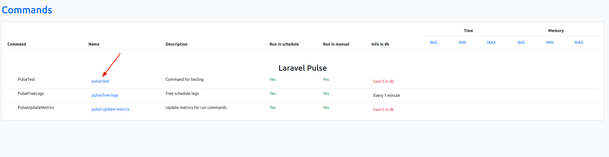
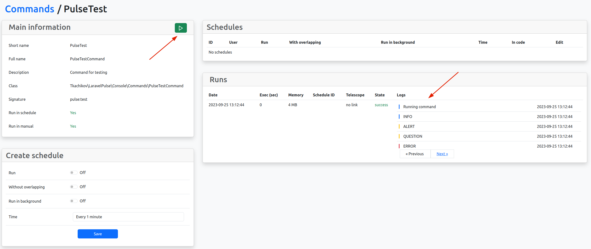
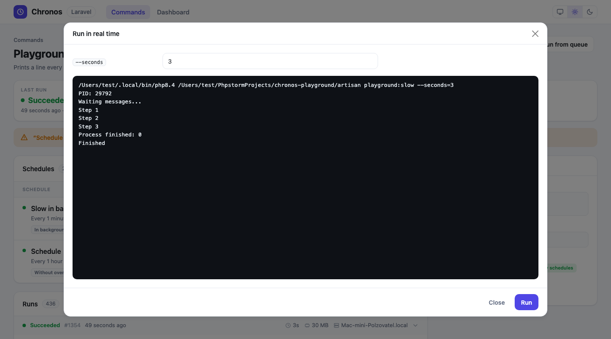
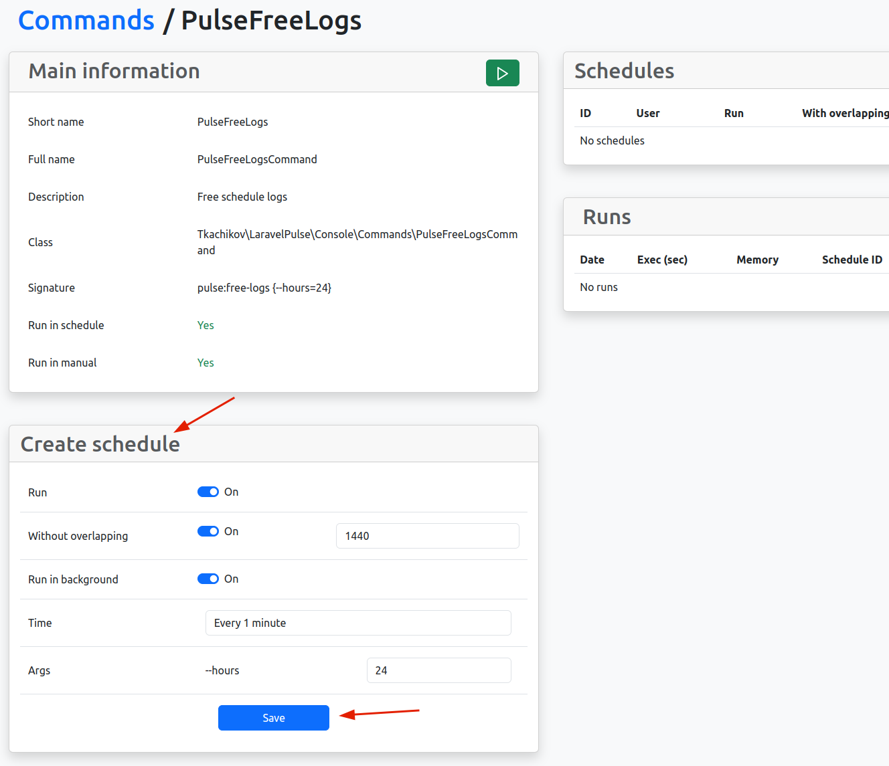
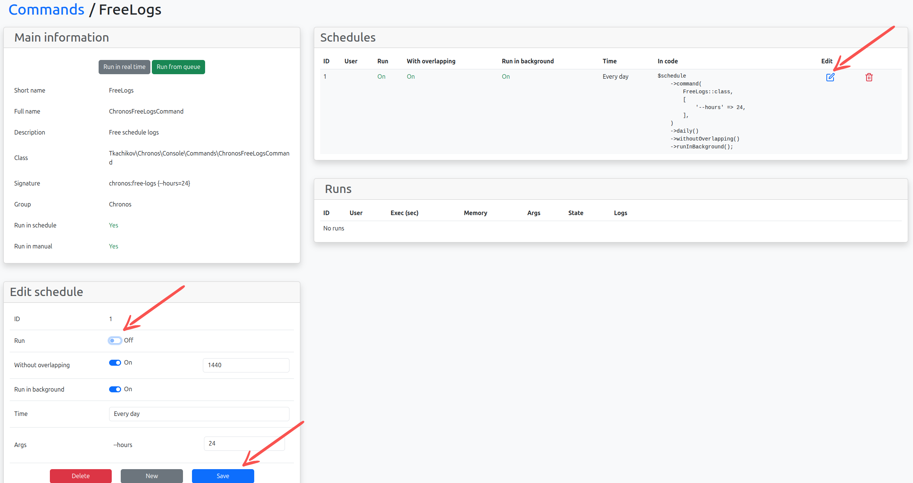

<p align="center">
    
</p>

<p align="center">
  <a href="https://packagist.org/packages/tkachikov/chronos"></a>
  <a href="https://packagist.org/packages/tkachikov/chronos"></a>
  
  
  
  
  <a href="https://opensource.org/licenses/MIT"></a>
</p>

<p align="center">
  <a href="https://github.com/tkachikov/chronos/stargazers"></a>
  <a href="https://github.com/tkachikov/chronos/issues"></a>
  <a href="https://github.com/tkachikov/chronos/commits/main"></a>
  <a href="https://github.com/tkachikov/chronos/actions/workflows/tests.yml"></a>
</p>

This package for setting commands in schedule.

## Installation

Require this package with composer using the following command
```shell
composer require tkachikov/chronos
```

Run Chronos command for install:
```shell
php artisan chronos:install
```

## Authorization

In defaults pages open for all users and also without auth middleware.

For open setting pages for authenticated users need uncommented 'auth' middleware in config `chronos.php`:
```php
return [
    'domain' => env('CHRONOS_DOMAIN'),

    'middlewares' => [
        'web',
        'auth',
        // 'Tkachikov\Chronos\Http\Middleware\Authorize',
    ],
];
```


For authorization in production uncommented Chronos auth in config `chronos.php` and set statements in `app/Providers/ChronosServiceProvider`:
```php
return [
    'domain' => env('CHRONOS_DOMAIN'),

    'middlewares' => [
        'web',
        'auth',
        'Tkachikov\Chronos\Http\Middleware\Authorize',
    ],
];
```
```php
// ...
class ChronosServiceProvider extends ChronosApplicationServiceProvider
{
    // ...
    protected function gate(): void
    {
        Gate::define('viewChronos', function ($user) {
            return $user->hasRole('admin');
        });
    }
}
```

## System commands

Only your application commands (`App\`) and Chronos commands can be run and scheduled from Chronos.
System commands (Laravel and other packages) are disabled by default.
To allow some of them, add their names or classes in config `chronos.php`:
```php
return [
    // ...

    'system_commands' => [
        'cache:clear',
        'queue:restart',
    ],
];
```

## Usage

Visit route `/chronos`, example: [localhost:8000/chronos](http://localhost:8000/chronos)

### For testing

Chronos has commands for testing (`chronos:test`, `chronos:answer`, `chronos:dd`, ...).
By default they are registered only in the `local` environment.
To enable or disable them explicitly set `CHRONOS_TEST_COMMANDS=true` or `false` in `.env`.

Open `chronos:test` command:


Run `chronos:test` command from queue and reload page:


Run `chronos:test` command in real time. Out messages pushing in custom terminal:


### Run attributes

If you need off run command from Chronos dashboard (`notRunInManual`) or schedules (`notRunInSchedule`) set in ChronosCommand attribute:
```php
// ...
use Tkachikov\Chronos\Attributes\ChronosCommand;

#[ChronosCommand(
    notRunInManual: false,
    notRunInSchedule: true,
)]
class TestCommand extends Command
{
    // ...
}
```

### Logging and states

For logging command messages and set status added trait `ChronosRunnerTrait`:
```php
// ...
class TestCommand extends Command
{
    use ChronosRunnerTrait;
    // ...
}
```

### Create schedules

Open your command and set params for it in `Create schedule` and save.


For off command click button edit, check to off `Run` and save:


## Group name

In default base class name directory for group name.<br>
You must be setting property `group` in `ChronosCommand` attribute. Example:

```php
// ...
use Tkachikov\Chronos\Attributes\ChronosCommand;

#[ChronosCommand(
    group: 'MyGroup',
)]
class TestCommand extends Command
{
    // ...
}
```

### Statistics

For calculate statistics run commands you must create schedule for `chronos:update-metrics`

## Monitoring

Chronos saves every `schedule:run` of each server and the last run of each schedule:

- the panel shows a banner when no server has run `schedule:run` for `CHRONOS_SCHEDULER_TIMEOUT` minutes (5 by default) while there are enabled schedules — e.g. cron is broken;
- schedules show the status and time of the last run, the next run and `Missed since` when a run due more than 2 minutes ago has not started;
- runs skipped by `withoutOverlapping` while the previous run goes on are counted (`Skipped N times`) and do not change the status and the start of the running run;
- `Lock is stuck` when the runs are skipped by `withoutOverlapping`, but no run of the command is running: the process that held the lock is gone (e.g. the server was restarted) and the lock is held until it expires (24 hours by default). Release it by `php artisan schedule:clear-cache`.

Each `schedule:run` finishes as killed the runs of its server whose process is gone without finishing them (SIGKILL, OOM, a restart), so they are not running forever. The state of runs is known only for commands with `ChronosRunnerTrait`: for other commands a lock is not considered stuck.

### Health check

`GET /chronos/health` returns `200` with `"status": "ok"`, or `503` with `"status": "fail"` when the scheduler is stopped, schedules have missed runs or stuck locks:

```json
{
    "status": "fail",
    "scheduler": {"status": "stopped", "last_run_at": "2026-10-16T11:46:11+00:00", "timeout_minutes": 5, "hosts": [{"host": "web-1", "last_run_at": "2026-10-16T11:46:11+00:00"}]},
    "schedules": {"enabled": 3, "missed": [{"id": 1, "name": "Import #1", "command": "App\\Console\\Commands\\ImportCommand", "missed_since": "2026-10-16T11:47:00+00:00"}], "stuck": [], "failed": 1, "running": 0}
}
```

By default it is behind the middlewares of the panel. For external monitoring (uptime checkers, Kubernetes probes, etc.) set a token: then it is available only by the token and without the middlewares of the panel.

```dotenv
CHRONOS_HEALTH_TOKEN=secret
```

```shell
curl -H "Authorization: Bearer secret" https://example.com/chronos/health
curl "https://example.com/chronos/health?token=secret"
```

The same check in console (exit code `1` when it fails):

```shell
php artisan chronos:health
php artisan chronos:health --json
```

### Dashboard

`GET /chronos/dashboard` is a full-screen page for a monitor, it refreshes itself every 5 seconds (`?refresh=10` to change). The theme is system, light or dark: by the switch in the header (saved in the browser) or by `?theme=dark` for a screen. It shows:

- the scheduler, commands running now with their elapsed time, runs, errors, the average time and memory of runs (with the slowest and the largest) for the last 24 hours, missed schedules;
- load of commands for the last 24 hours as lines by hours: the peak of runs going on at once and of their memory, with the number of runs and the commands in the tooltip; next to it the top commands by the total time of runs (runs, errors, average time, max memory);
- columns in the order of a run: upcoming runs of schedules with a countdown → running now → problems (missed schedules; failed and killed runs grouped by commands with their counts, joined with failed schedules of the commands) or recent runs with their duration and memory; new rows are highlighted.

Runs are shown for commands with `ChronosRunnerTrait`. The data is available as JSON by `GET /chronos/dashboard/data`.

By default it is behind the middlewares of the panel. For a screen without a login set a token: then the dashboard is available only by the token and without the middlewares of the panel.

```dotenv
CHRONOS_DASHBOARD_TOKEN=secret
```

```
https://example.com/chronos/dashboard?token=secret
```

## License

This package is open-sourced software licensed under the [MIT license](https://opensource.org/licenses/MIT).
