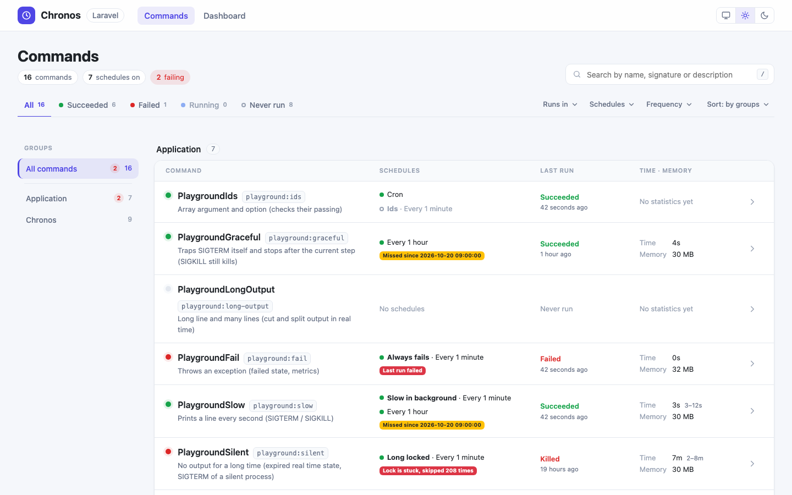
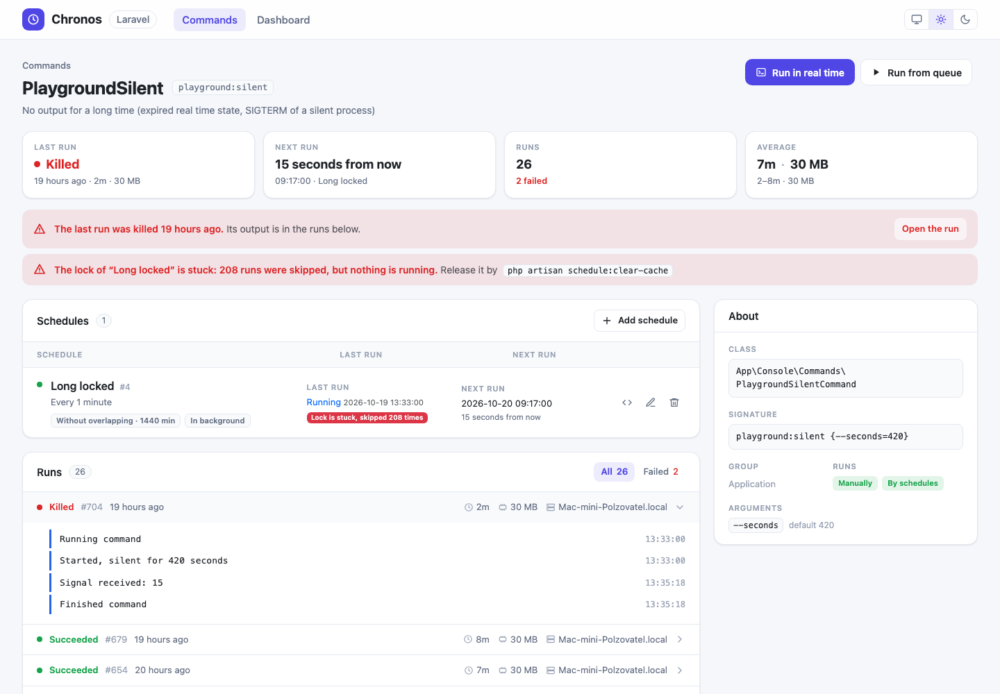
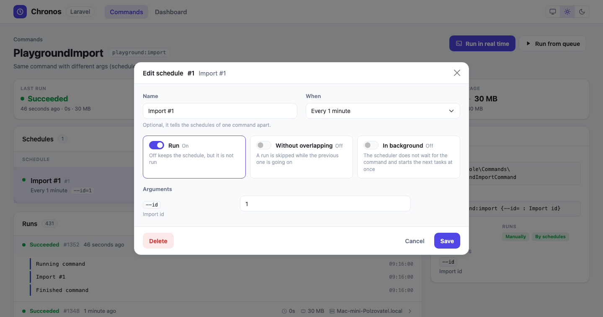
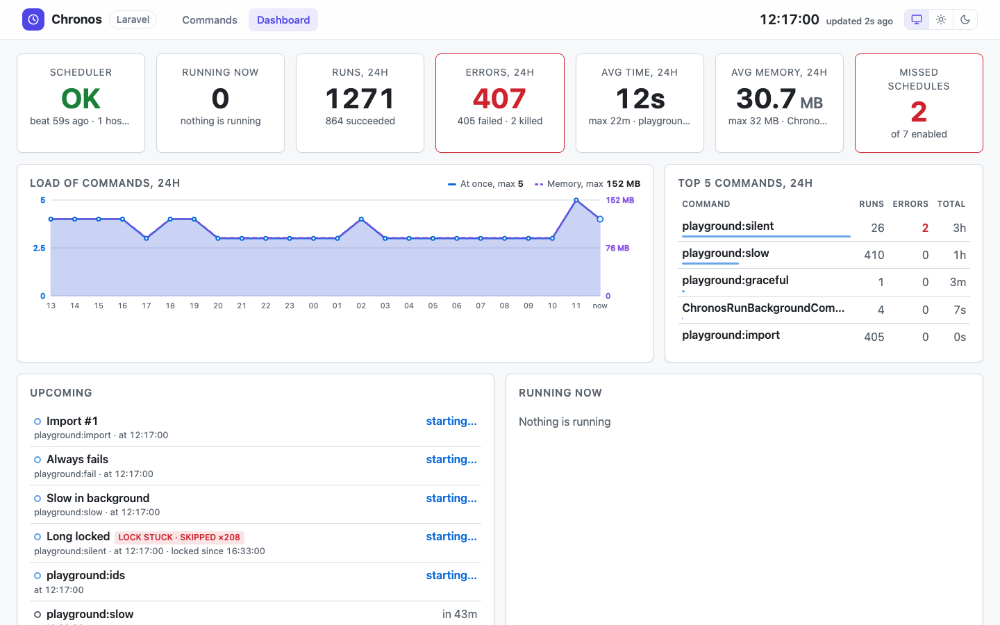

<p align="center">
    
</p>

<p align="center">
  <a href="https://packagist.org/packages/tkachikov/chronos"></a>
  <a href="https://packagist.org/packages/tkachikov/chronos"></a>
  
  
  
  
  <a href="https://opensource.org/licenses/MIT"></a>
</p>

<p align="center">
  <a href="https://github.com/tkachikov/chronos/stargazers"></a>
  <a href="https://github.com/tkachikov/chronos/issues"></a>
  <a href="https://github.com/tkachikov/chronos/commits/main"></a>
  <a href="https://github.com/tkachikov/chronos/actions/workflows/tests.yml"></a>
</p>

Chronos is a panel for the artisan commands of a Laravel application: run them from the browser, schedule them without a deploy, and watch the scheduler, the runs and the errors.

- **Commands** of the application in one list: grouped, searchable, with the state of the last run, the schedules and the average time and memory of runs.
- **Runs** from the panel: from the queue, or in real time with the output in a terminal, answers to the questions of the command and `SIGTERM`/`SIGKILL`.
- **Schedules** in a window: the frequency (every minute, hourly, daily at…, cron), `withoutOverlapping`, `runInBackground`, arguments and options, including arrays. A schedule is stored in the database, so it is changed without a deploy.
- **Monitoring**: the last and the next run of each schedule, missed runs, stuck locks, a stopped scheduler; a health check for uptime checkers and a real-time dashboard for a monitor.



## Requirements

PHP 8.2+, Laravel 10, 11, 12 or 13.

## Installation

```shell
composer require tkachikov/chronos
php artisan chronos:install
```

`chronos:install` publishes the config to `config/chronos.php`, the provider to `app/Providers/ChronosServiceProvider.php` and runs the migrations.

Register the published provider: in `bootstrap/providers.php` (Laravel 11+) or in the `providers` of `config/app.php` (Laravel 10):

```php
return [
    App\Providers\AppServiceProvider::class,
    App\Providers\ChronosServiceProvider::class,
];
```

The panel is at `/chronos`, e.g. [localhost:8000/chronos](http://localhost:8000/chronos). To serve it on its own domain set `CHRONOS_DOMAIN` in `.env`.

## Authorization

By default the panel is open to everyone: only the `web` middleware is applied. To open it to authenticated users only, uncomment `auth` in the `middlewares` of `config/chronos.php`:

```php
'middlewares' => [
    'web',
    'auth',
    // 'Tkachikov\Chronos\Http\Middleware\Authorize',
],
```

To open it to some users only, uncomment `Authorize` too and define the `viewChronos` gate in the published `app/Providers/ChronosServiceProvider.php`. In the `local` environment the gate is not checked.

```php
class ChronosServiceProvider extends ChronosApplicationServiceProvider
{
    protected function gate(): void
    {
        Gate::define('viewChronos', function ($user) {
            return $user->hasRole('admin');
        });
    }
}
```

## Which commands are in the panel

The commands of the application (`App\Console\Commands`) and the service commands of Chronos. System commands (Laravel and other packages) are not available by default: to allow some of them, add their names or classes to `system_commands` in `config/chronos.php`:

```php
'system_commands' => [
    'cache:clear',
    'queue:restart',
],
```

Chronos has commands for trying the panel (`chronos:test`, `chronos:answer`, `chronos:dd`, …). They are registered in the `local` environment only; `CHRONOS_TEST_COMMANDS=true` or `false` in `.env` enables or disables them explicitly.

## Commands

The list shows every command with its signature and description, the schedules, the state and the time of the last run, the average time and memory of runs. The commands are grouped by the directory of the class or by the `group` of the attribute (see below), the groups are on the left.

The list is searched by the name, the signature or the description, and filtered by the last run (succeeded, failed, running, never run), by where the command runs (manually, by schedules), by the schedules (none, one, several, some off) and by their frequency. Every option shows how many commands it gives with the other filters. The list is sorted by the groups or by the average, the minimum or the maximum time and memory of runs.

### The page of a command



The page shows the last run, the next run among the schedules that are on, the number of runs with the failed ones, and the average time and memory with their range. When something needs attention, it is said with what to do: the last run failed or was killed, the lock of a schedule is stuck, a run was due and has not started, the command is run nowhere.

- **Schedules**: each one with its frequency, arguments, flags, the last and the next run; the same schedule as code for the scheduler of Laravel opens under the row.
- **Runs**: the latest first, the output of a run opens under it; the latest and the failed runs are open at once. The runs are filtered by all, failed and running.
- **About**: the class, the signature, the group, the ways to run and the arguments with their descriptions and defaults.

### Running a command

**Run from the queue** dispatches a job to the queue of the application (a queue worker has to be running, or the queue driver has to be `sync`). One run of a command at a time: while it is in the queue or running, a second run from the queue is skipped.

**Run in real time** starts the command as a process on the web server and streams its output to a terminal in the window. A question of the command (`ask`, `confirm`, …) is answered in the terminal, the process is stopped by `SIGTERM` or `SIGKILL`. The PHP binary is found automatically; set `CHRONOS_PHP_BINARY` when it has to be another one (e.g. under php-fpm).


Both ways ask for the arguments and the options of the command, with their descriptions, defaults and the values of arrays. The state of a run, its output, time and memory are stored for commands with `ChronosRunnerTrait` (see below).

### Schedules

A schedule is added by the button on the page of a command, or edited by its row, in a window:



- **Name** tells the schedules of one command apart, e.g. `Nightly import` and `Hourly import` with different arguments.
- **When**: every few seconds, minutes or hours, hourly at a minute, daily at a time, twice a day, weekly, monthly and others, or a cron expression.
- **Run**: off keeps the schedule, but it is not run.
- **Without overlapping**: a run is skipped while the previous one is going on; the lock expires in the given minutes (1440 by default), as `withoutOverlapping()` of Laravel.
- **In background**: the scheduler does not wait for the command and starts the next tasks at once, as `runInBackground()`.
- **Arguments** and options of the command, including arrays (a value each).

Schedules are registered in the scheduler of Laravel from the database on every `schedule:run`, so the usual `php artisan schedule:run` in cron (or `schedule:work`) runs them together with the schedules of `routes/console.php`.

### Attributes of a command

The `ChronosCommand` attribute sets the group of a command in the list and forbids the ways to run it:

```php
use Tkachikov\Chronos\Attributes\ChronosCommand;

#[ChronosCommand(
    group: 'Imports',
    notRunInManual: false,
    notRunInSchedule: true,
)]
class ImportCommand extends Command
{
    // ...
}
```

Without `group` the command is grouped by the directory of its class under `app/Console/Commands` (the commands in the root are the `Application` group).

### Logging and states

Add `ChronosRunnerTrait` to a command to store its runs: the state (succeeded, failed, running, killed), the messages written by `info`, `line`, `error`, … as the output of the run, the time and the memory. The trait is needed for the states on the pages, the statistics, the dashboard and the detection of stuck locks.

```php
use Tkachikov\Chronos\Traits\ChronosRunnerTrait;

class ImportCommand extends Command
{
    use ChronosRunnerTrait;
    // ...
}
```

### Statistics and old runs

The average, the minimum and the maximum time and memory of runs are counted by `chronos:update-metrics`: add a schedule for it (e.g. hourly). Old runs and their output are deleted by `chronos:free-logs` (older than 24 hours, `--hours=` to change): schedule it too.

## Monitoring

Chronos stores every `schedule:run` of each server and the last run of each schedule:

- the panel shows a banner when no server has run `schedule:run` for `CHRONOS_SCHEDULER_TIMEOUT` minutes (5 by default) while there are enabled schedules, e.g. cron is broken;
- each schedule shows the status and the time of the last run, the next run, and `Missed since` when a run due more than 2 minutes ago has not started;
- runs skipped by `withoutOverlapping` while the previous run goes on are counted (`Skipped N times`) and do not change the status and the start of the running run;
- `Lock is stuck` means the runs are skipped by `withoutOverlapping`, but no run of the command is running: the process that held the lock is gone (e.g. the server was restarted) and the lock is held until it expires. Release it by `php artisan schedule:clear-cache`.

Each `schedule:run` finishes as killed the runs of its server whose process is gone without finishing (SIGKILL, OOM, a restart), so they are not running forever. The state of runs is known only for commands with `ChronosRunnerTrait`: for other commands a lock is not considered stuck.

### Health check

`GET /chronos/health` returns `200` with `"status": "ok"`, or `503` with `"status": "fail"` when the scheduler is stopped, schedules have missed runs or stuck locks:

```json
{
    "status": "fail",
    "scheduler": {"status": "stopped", "last_run_at": "2026-10-16T11:46:11+00:00", "timeout_minutes": 5, "hosts": [{"host": "web-1", "last_run_at": "2026-10-16T11:46:11+00:00"}]},
    "schedules": {"enabled": 3, "missed": [{"id": 1, "name": "Import #1", "command": "App\\Console\\Commands\\ImportCommand", "missed_since": "2026-10-16T11:47:00+00:00"}], "stuck": [], "failed": 1, "running": 0}
}
```

By default it is behind the middlewares of the panel. For external monitoring (uptime checkers, Kubernetes probes, etc.) set a token: then it is available by the token only and without the middlewares of the panel.

```dotenv
CHRONOS_HEALTH_TOKEN=secret
```

```shell
curl -H "Authorization: Bearer secret" https://example.com/chronos/health
curl "https://example.com/chronos/health?token=secret"
```

The same check in the console (the exit code is `1` when it fails):

```shell
php artisan chronos:health
php artisan chronos:health --json
```

### Dashboard

`GET /chronos/dashboard` is a full-screen page for a monitor, it refreshes itself every 5 seconds (`?refresh=10` to change). The theme is system, light or dark: by the switch in the bar (saved in the browser) or by `?theme=dark` for a screen.



It shows:

- the scheduler, the commands running now with their elapsed time, the runs, the errors, the average time and memory of runs (with the slowest and the largest) for the last 24 hours, the missed schedules;
- the load of commands for the last 24 hours as lines by hours: the peak of runs going on at once and of their memory, with the number of runs and the commands in the tooltip; next to it the top 5 commands by the total time of runs (runs, errors, average time, max memory);
- the columns in the order of a run: the upcoming runs of schedules with a countdown → running now → problems (missed schedules; failed and killed runs grouped by commands with their counts, joined with the failed schedules of the commands) or recent runs with their duration and memory; new rows are highlighted.

Runs are shown for commands with `ChronosRunnerTrait`. The data is available as JSON by `GET /chronos/dashboard/data`.

By default it is behind the middlewares of the panel. For a screen without a login set a token: then the dashboard is available by the token only and without the middlewares of the panel.

```dotenv
CHRONOS_DASHBOARD_TOKEN=secret
```

```
https://example.com/chronos/dashboard?token=secret
```

## Configuration

`config/chronos.php`, published by `chronos:install`:

| Key | Env | Default | What it is |
| --- | --- | --- | --- |
| `domain` | `CHRONOS_DOMAIN` | — | The domain of the panel, the application's one by default. |
| `middlewares` | | `['web']` | The middlewares of the panel: add `auth` and `Authorize` as above. |
| `system_commands` | | `[]` | System commands (names or classes) that can be run and scheduled. |
| `test_commands` | `CHRONOS_TEST_COMMANDS` | `local` only | The commands for trying the panel. |
| `php_binary` | `CHRONOS_PHP_BINARY` | found automatically | The PHP binary for running in real time. |
| `monitoring.scheduler_timeout` | `CHRONOS_SCHEDULER_TIMEOUT` | `5` | Minutes without `schedule:run` after which the scheduler is stopped. |
| `monitoring.health_token` | `CHRONOS_HEALTH_TOKEN` | — | The token of the health check. |
| `monitoring.dashboard_token` | `CHRONOS_DASHBOARD_TOKEN` | — | The token of the dashboard. |

## License

This package is open-sourced software licensed under the [MIT license](https://opensource.org/licenses/MIT).
